<div align="center">

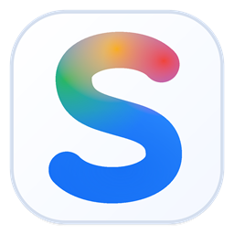

# Sefiros POS

**Punto de Venta Multicaja & Gestión Comercial ERP de Alto Rendimiento en .NET 10**

[](https://github.com/Memorysinc/Serifos-POS/actions/workflows/dotnet.yml)
[](https://github.com/Memorysinc/Serifos-POS/releases/latest)


<br/>

**[⬇️ Descargar Sefiros POS (.exe listo para usar)](https://github.com/Memorysinc/Serifos-POS/releases/latest/download/Sefiros-POS-win-x64.exe)** · **[📦 Pack Portable + SQL](https://github.com/Memorysinc/Serifos-POS/releases/latest)** · **[📸 Galería de Temas](#-galería-visual--pantalla-de-inicio-temas-y-diseños-pos)** · **[🌎 Monedas LATAM](#-todas-las-monedas-de-latinoamérica-20-latam--eur)**

</div>

---

<p align="center">
  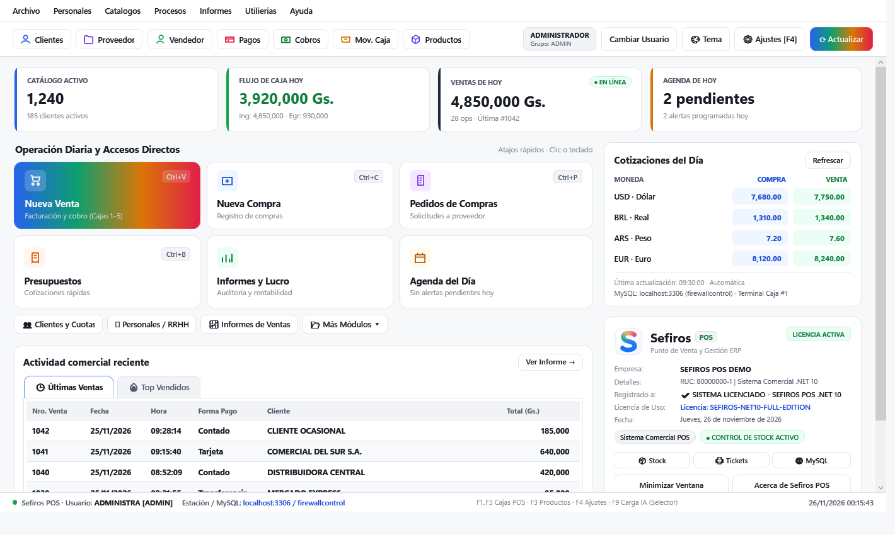
</p>

> **Por qué existe Sefiros POS:** Construido desde cero en **C# / .NET 10 (WPF + MVVM)** para comercios que cobran a toda velocidad por teclado y escáner de códigos de barras: **5 cajas en paralelo (`F1`–`F5`)**, cambio en vivo entre **diseño Renovado** y **diseño Clásico FOX**, **20 monedas de Latinoamérica + Euro**, **3 idiomas en caliente** y arranque inmediato en **Modo Fábrica**.
>
> **Atribución y origen:** Este repositorio contiene **exclusivamente el código moderno en C# `.NET 10`**. La lógica fiscal, cálculos de comprobantes, operativa multicaja (`ABMVENTAS`, `ITEMSFACTURAVENTAS`), botoneras pesables (`Genes`) y atajos rápidos fueron inspirados y migrados desde el sistema heredado **Visual FoxPro 9 (`Sufer POS / FireWall Control`)**.

---

## ⚡ Descarga Directa — 1 Solo `.exe` Listo para Ejecutar

**¿No quieres compilar código ni instalar el SDK de .NET?** Ve directo a la última versión en **[GitHub Releases](https://github.com/Memorysinc/Serifos-POS/releases/latest)**:

| Archivo | Tamaño aprox. | Para quién es |
| :--- | :---: | :--- |
| **[`Sefiros-POS-win-x64.exe`](https://github.com/Memorysinc/Serifos-POS/releases/latest/download/Sefiros-POS-win-x64.exe)** | ~64 MB | **1 solo clic:** ejecutable único autocontenido para Windows 10/11 (x64). Incluye runtime `.NET 10`, arranca al instante en **Modo Fábrica** sin dependencias externas. |
| **[`Sefiros-POS-win-x64-PortablePack.zip`](https://github.com/Memorysinc/Serifos-POS/releases/latest)** | ~64 MB | Mismo ejecutable único + esquema MySQL limpio ([`database/sefiros_factory_schema.sql`](database/sefiros_factory_schema.sql)) y plantillas de configuración ([`config/`](config/)). |

> **Primera ejecución sin complicaciones:** haz doble clic en `Sefiros-POS-win-x64.exe`. El sistema abre con su animación de inicio, Tema Sefiros, idioma Español y moneda Guaraní (`PYG`). Cuando quieras guardar tus ventas y catálogo en MySQL, abre **⚙ Ajustes `[F4]` → Multiconexión MySQL** e importa [`database/sefiros_factory_schema.sql`](database/sefiros_factory_schema.sql).

---

## ✨ Lo que hace único a Sefiros POS

- **5 Cajas Simultáneas (`F1`–`F5`):** carritos independientes por caja, cambio instantáneo y cierre individual sin afectar las demás ventas abiertas.
- **Doble Estilo Intercambiable en Caliente:** alterna entre **Diseño Renovado (Atelier)** con ventanas en cascada + visor de *Stock Actual* y **Diseño Clásico (Sufer POS / FOX)** con barra y distribución tradicional, **sin perder ni un ítem del carrito**.
- **Velocidad Real para Cajero y Escáner:** guardián de foco automático, modo **Movimiento Rápido (`F10`)** con fusión automática de escaneos, productos pesables fraccionables (`KG`) hasta 3–6 decimales y **Genes (`A/S/D/F`)** para verdulería, carnicería, panadería y almacén.
- **Modo Modal 1 Win32 Nativo:** bloquea la ventana padre sin volver gris ni opacar visualmente los botones o totales.
- **Presentación de Inicio Animada & Audio Estéreo:** splash vectorial propio (`SefirosSplashWindow`) con trazado progresivo de la `S`, cometa orbital, destello especular, aura prismática, 6 estrellas astroide y melodía orgánica sintetizada en PCM estéreo (`SefirosStartupSoundService`).
- **Impresión Térmica 80mm RAW ESC/POS & Factura Legal:** impresión directa a impresoras Windows/ESC-POS, apertura automática de cajón de dinero, corte de papel y control exacto de copias.
- **ERP Comercial Completo:** Compras, Pedidos, Proveedores, Clientes y Cuotas, Movimientos de Caja, Agenda, RRHH, Traslados entre depósitos, Informes de Lucro, Multiconexión LAN y Carga Rápida asistida por IA (opcional con API Key del comercio).

---

## 📸 Galería Visual — Pantalla de Inicio, Temas y Diseños POS

### 1. Presentación Animada de Inicio

<p align="center">
  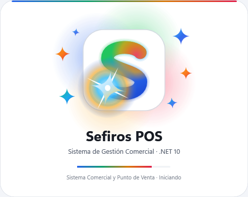
</p>

### 2. Todos los 8 Temas Visuales + Modo Oscuro + Ajustes Regionales

Cambia de tema y activa el **Modo Oscuro** en tiempo real desde **🎨 Tema** o **⚙ Ajustes `[F4]` → Apariencia**:

<table>
  <tr>
    <td align="center" width="50%">
      <strong>✨ Tema Sefiros (Oficial · Claro)</strong><br/><br/>
      
    </td>
    <td align="center" width="50%">
      <strong>🌑 Tema Sefiros (Modo Oscuro Obsidiana)</strong><br/><br/>
      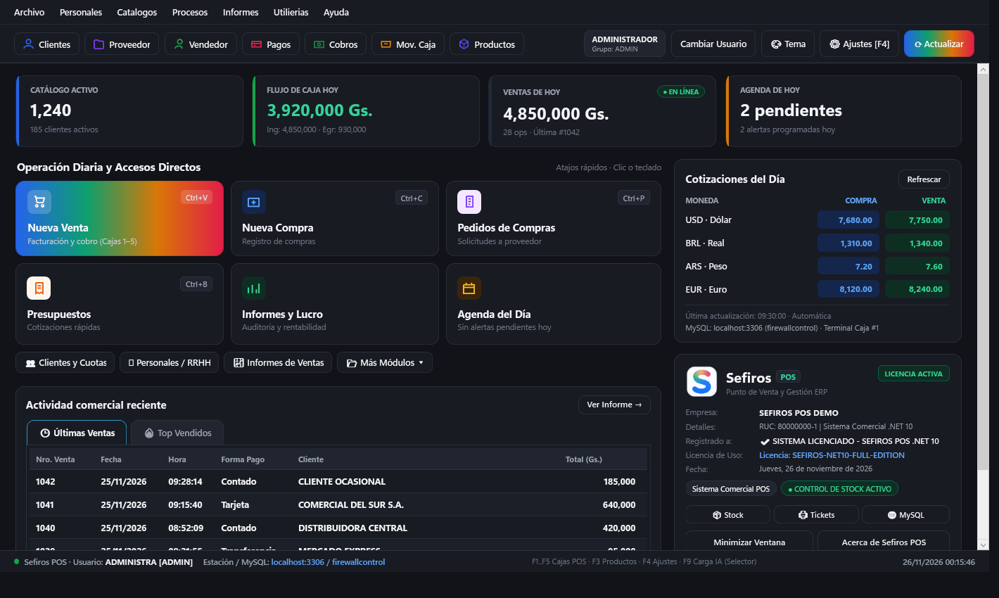
    </td>
  </tr>
  <tr>
    <td align="center">
      <strong>🖤 Neutro Carbón</strong><br/><br/>
      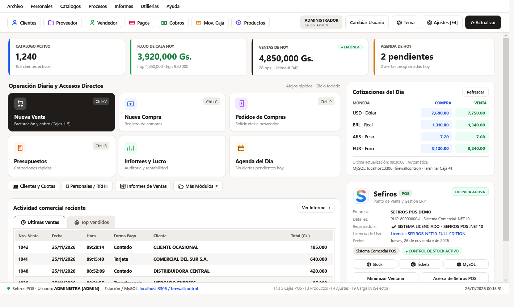
    </td>
    <td align="center">
      <strong>🌊 Océano Azul</strong><br/><br/>
      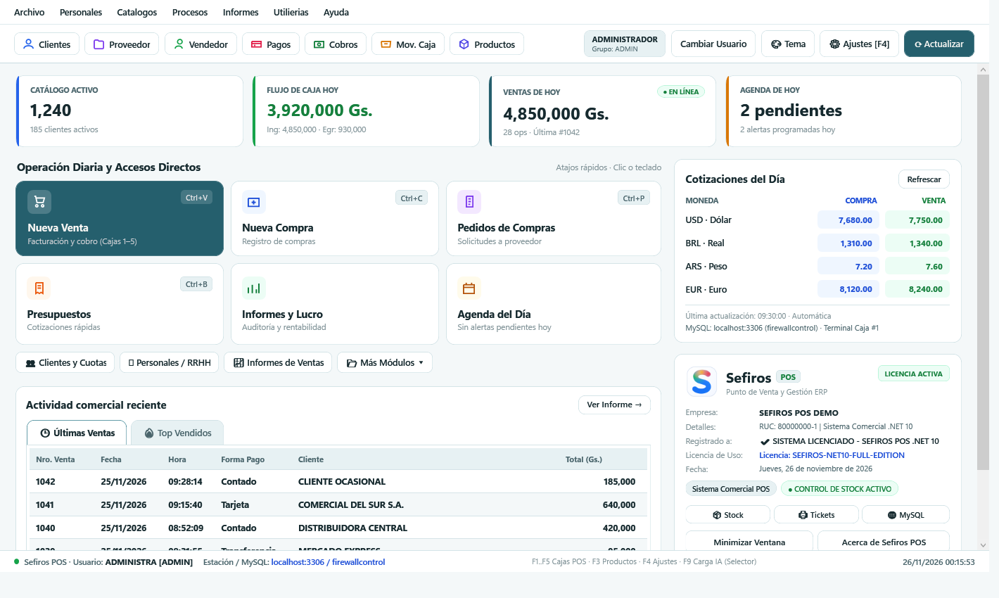
    </td>
  </tr>
  <tr>
    <td align="center">
      <strong>🌿 Verde Esmeralda</strong><br/><br/>
      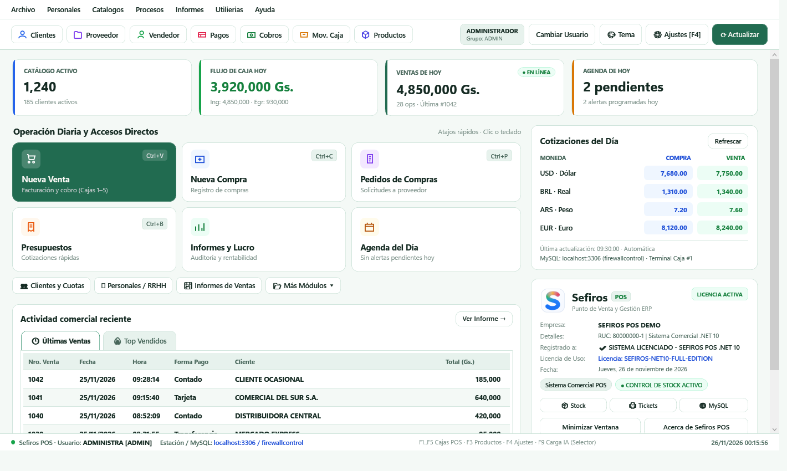
    </td>
    <td align="center">
      <strong>🌸 Rosa Palo</strong><br/><br/>
      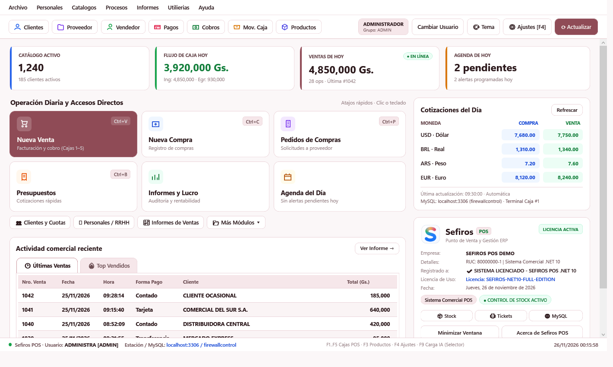
    </td>
  </tr>
  <tr>
    <td align="center">
      <strong>🔮 Azul Índigo</strong><br/><br/>
      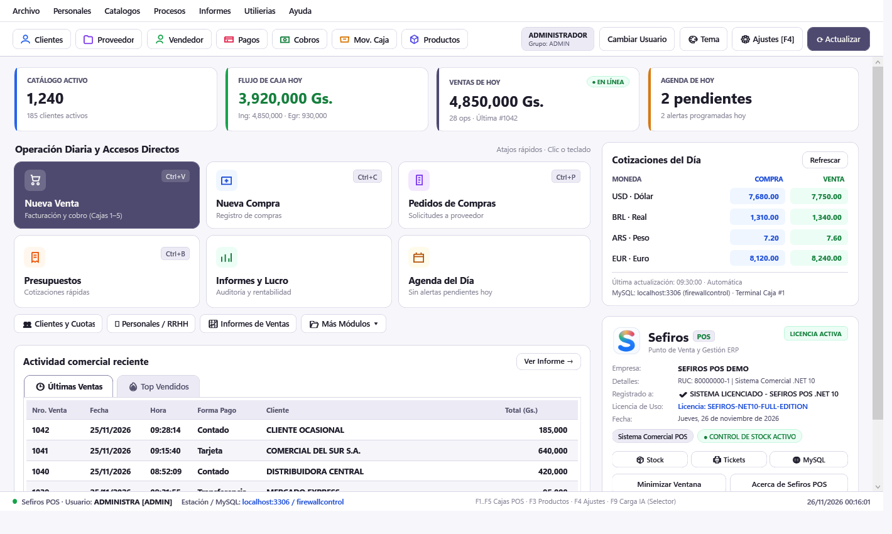
    </td>
    <td align="center">
      <strong>🏜 Arena Suave</strong><br/><br/>
      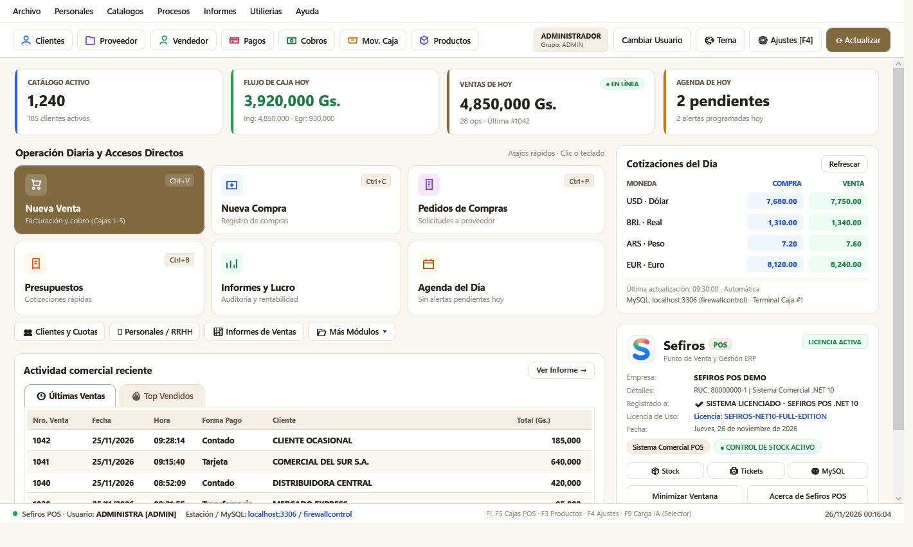
    </td>
  </tr>
  <tr>
    <td align="center">
      <strong>✨ Dorado Atelier</strong><br/><br/>
      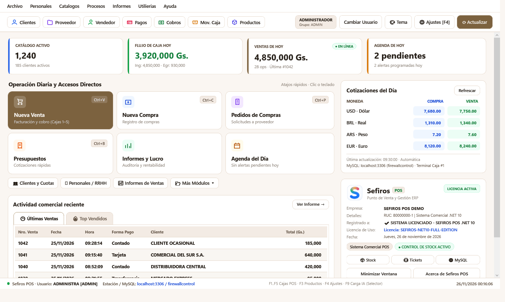
    </td>
    <td align="center">
      <strong>⚙ Ajustes · Diseño, Idiomas y 21 Monedas LATAM</strong><br/><br/>
      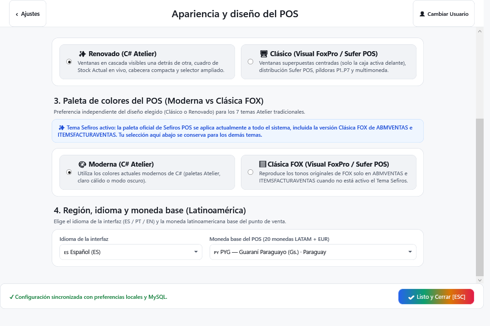
    </td>
  </tr>
</table>

### 3. Doble Estilo de Punto de Venta (`Renovado` vs. `Clásico FOX`)

<table>
  <tr>
    <td align="center" width="33.3%">
      <strong>Diseño Renovado (Tema Sefiros)</strong><br/><br/>
      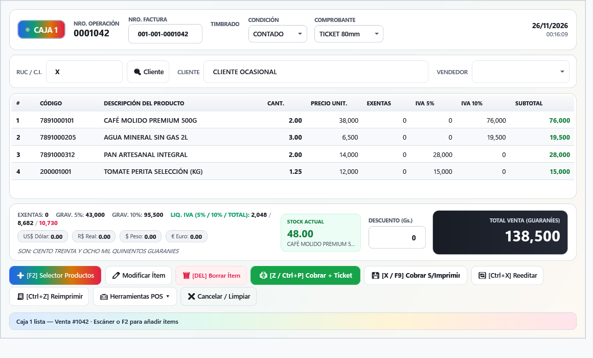
    </td>
    <td align="center" width="33.3%">
      <strong>Diseño Clásico FOX (Paleta Original)</strong><br/><br/>
      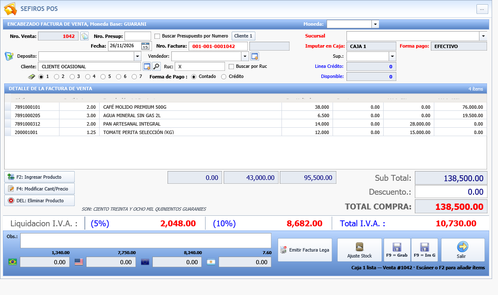
    </td>
    <td align="center" width="33.3%">
      <strong>Diseño Clásico + Tema Sefiros</strong><br/><br/>
      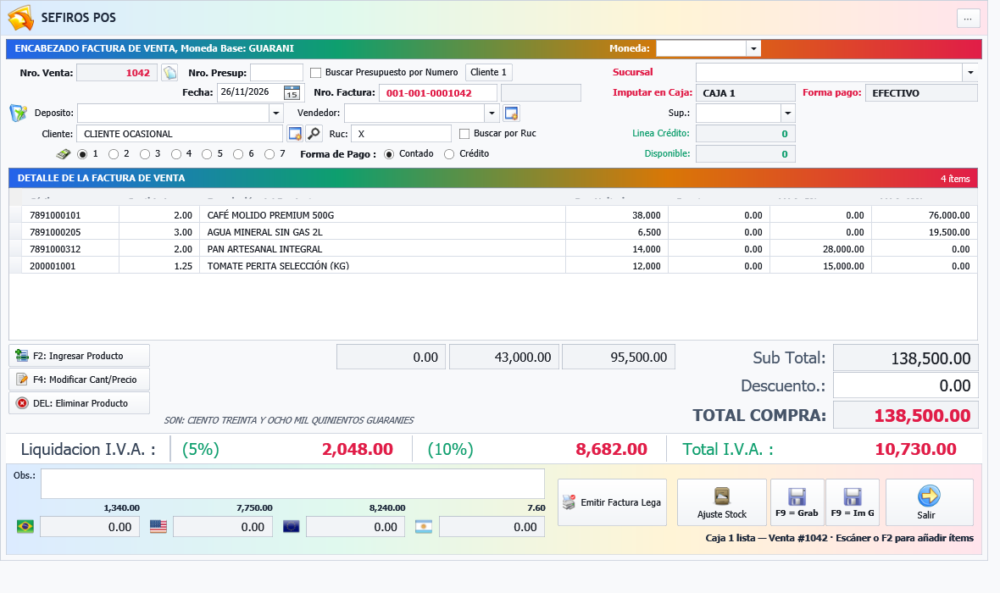
    </td>
  </tr>
</table>

---

## 🌎 Todas las Monedas de Latinoamérica (`20 LATAM + EUR`)

Desde **⚙ Ajustes `[F4]` → Apariencia → Región, idioma y moneda base** puedes elegir la moneda base de tu comercio y sembrar todas las monedas con **"🌎 Cargar Monedas LATAM"** en el catálogo maestro. Incluye conversión automática, formateo regional, impresión en tickets 80mm y escritura de montos en letras (`VfpCompat.Letras`):

<details>
<summary><strong>Ver tabla completa de las 21 monedas soportadas</strong></summary>

| Código | Moneda | Símbolo | País / Región |
| :--- | :--- | :---: | :--- |
| `PYG` | Guaraní Paraguayo *(por defecto de fábrica)* | `Gs.` | Paraguay |
| `ARS` | Peso Argentino | `$` | Argentina |
| `BOB` | Boliviano | `Bs` | Bolivia |
| `BRL` | Real Brasileño | `R$` | Brasil |
| `CLP` | Peso Chileno | `$` | Chile |
| `COP` | Peso Colombiano | `$` | Colombia |
| `CRC` | Colón Costarricense | `₡` | Costa Rica |
| `CUP` | Peso Cubano | `$` | Cuba |
| `DOP` | Peso Dominicano | `RD$` | Rep. Dominicana |
| `USD` | Dólar Estadounidense | `US$` | Ecuador / El Salvador / Panamá / Regional |
| `GTQ` | Quetzal Guatemalteco | `Q` | Guatemala |
| `HNL` | Lempira Hondureño | `L` | Honduras |
| `HTG` | Gourde Haitiano | `G` | Haití |
| `MXN` | Peso Mexicano | `$` | México |
| `NIO` | Córdoba Nicaragüense | `C$` | Nicaragua |
| `PAB` | Balboa Panameño | `B/.` | Panamá |
| `PEN` | Sol Peruano | `S/` | Perú |
| `UYU` | Peso Uruguayo | `$U` | Uruguay |
| `VES` | Bolívar Venezolano | `Bs.` | Venezuela |
| `BZD` | Dólar Beliceño | `BZ$` | Belice |
| `EUR` | Euro *(referencia internacional)* | `€` | Internacional |

</details>

## 🌐 Multi-Idioma en Caliente (`ES` · `PT` · `EN`)

Cambia al instante entre **Español (`es`)**, **Português (`pt`)** e **English (`en`)** desde Ajustes sin reiniciar ni cerrar las ventanas de caja abiertas.

---

## 🛠 Compilar y Ejecutar desde Código Fuente

### Requisitos
- **Windows 10 / 11 (x64)**
- **[.NET 10 SDK](https://dotnet.microsoft.com/download)**
- **MySQL 5.5+ / 8.0+ o MariaDB** *(opcional para probar el dashboard en Modo Fábrica; necesario para persistir catálogo y ventas)*

```powershell
# 1. Clonar el repositorio
git clone https://github.com/Memorysinc/Serifos-POS.git
cd Serifos-POS

# 2. Restaurar, compilar y ejecutar las 47 pruebas automatizadas
dotnet restore .\FirewallControl.sln
dotnet test .\FirewallControl.sln --configuration Release --verbosity normal

# 3. Ejecutar directamente
dotnet run --project .\src\FirewallControl.App\FirewallControl.App.csproj

# 4. Generar tu propio ejecutable único autocontenido (1 solo .exe, ~64 MB)
dotnet publish .\src\FirewallControl.App\FirewallControl.App.csproj `
  -c Release -r win-x64 --self-contained true `
  -p:PublishSingleFile=true -p:IncludeNativeLibrariesForSelfExtract=true -p:EnableCompressionInSingleFile=true `
  -o .\publish\singlefile
```

### Inicializar Base de Datos de Fábrica *(Opcional)*
```powershell
mysql -u root -p < .\database\sefiros_factory_schema.sql
```
- **Usuario administrador inicial:** `ADMINISTRA` / **Contraseña de fábrica:** `123456` *(cámbiala en **Mi perfil** al pasar a producción)*.

---

## ⌨ Atajos Principales del Teclado

| Ventana | Tecla | Acción |
| :--- | :---: | :--- |
| Inicio (`MainWindow`) | `F1`–`F5` | Abrir o alternar entre Cajas 1 a 5 |
| Inicio (`MainWindow`) | `F3` / `F4` | Productos / Ajustes y Preferencias |
| Punto de Venta | `F2` / `F9` / `Ctrl+P` | Selector de ítems / Cobrar / Cobrar e imprimir |
| Selector de Ítems | `F10` / `A, S, D, F` / `Z` / `X` | Movimiento Rápido / Genes / Cobro c/ ticket / Cobro s/ ticket |

---

## 🏗 Arquitectura del Proyecto

```text
├── FirewallControl.sln
├── src/
│   ├── FirewallControl.Core/           # Sefiros.Core.dll — Entidades, interfaces, LatamCurrencyCatalog, cálculo POS
│   ├── FirewallControl.Infrastructure/ # Sefiros.Infrastructure.dll — MySQL/Dapper, ConfigService, ESC/POS, DBF compat
│   ├── FirewallControl.App/            # Sefiros.App.exe — UI WPF MVVM, Temas, Multi-idioma, Vistas y Splash
│   └── FirewallControl.Tests/          # Suite xUnit (47 pruebas: cálculo, temas, monedas LATAM, UX compacta, seguridad)
├── database/
│   └── sefiros_factory_schema.sql      # Esquema MySQL limpio de fábrica + 21 monedas LATAM (sin datos privados)
├── config/
│   ├── FireWall.Ini.example            # Plantilla limpia de configuración local
│   └── preferencias_atajos.example.json# Plantilla de preferencias de fábrica
├── docs/
│   ├── ARQUITECTURA.md                 # Documentación técnica detallada
│   └── screenshots/                    # Galería oficial de capturas de todos los temas y vistas POS
└── .github/workflows/
    ├── dotnet.yml                      # CI automatizado (build + 47 pruebas en windows-latest)
    └── release.yml                     # Publicación automática de 1 solo .exe + PortablePack en GitHub Releases
```

Más detalles técnicos en [`docs/ARQUITECTURA.md`](docs/ARQUITECTURA.md).

## 🔐 Seguridad y Licencia
- Repositorio auditado automáticamente (`Stage6GitHubReadinessTests.SecurityAudit_ZeroPersonalPathsOrCredentialsInSourceTree`): **0 credenciales, 0 rutas privadas y 0 archivos heredados de FoxPro**. Consulta [`SECURITY.md`](SECURITY.md).
- Distribuido bajo la licencia [MIT](LICENSE).
